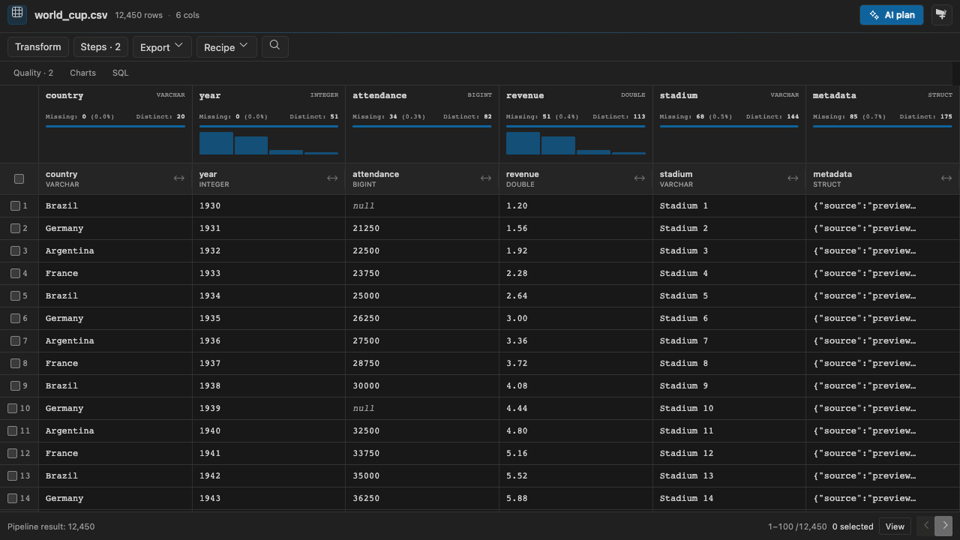
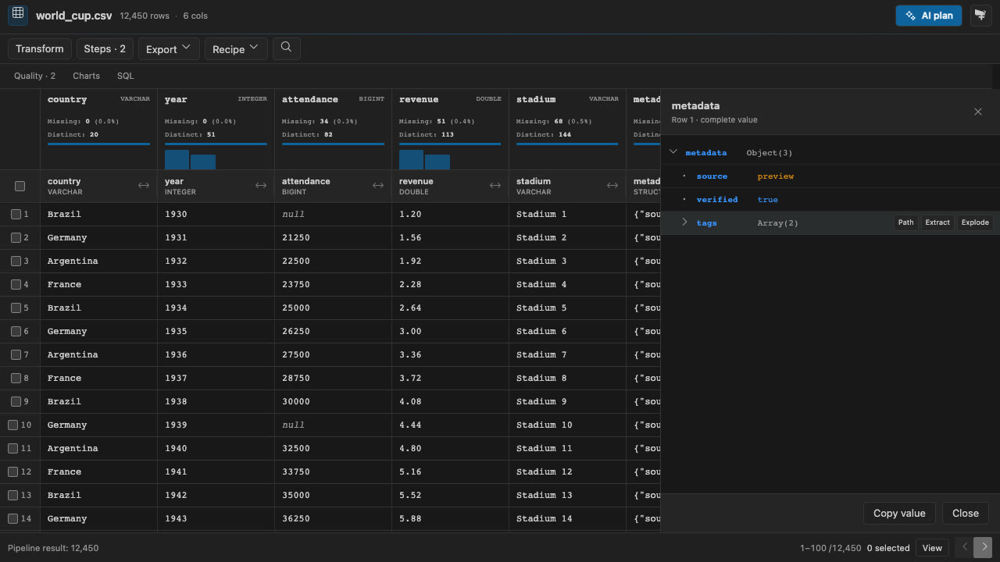

<p align="center">
  
</p>

<h1 align="center">QuackWrangler</h1>

<p align="center"><strong>Open, clean, explore, and export data without leaving VS Code.</strong><br>
Built-in DuckDB. No Python. No Jupyter. No database to set up. <strong>Your data never leaves your machine.</strong></p>

<p align="center">
  <a href="https://marketplace.visualstudio.com/items?itemName=quackwrangler.quackwrangler"></a>
  <a href="https://github.com/mohsinsurani/quackwrangler/actions/workflows/ci.yml"></a>
  
  
  
  <a href="LICENSE"></a>
  
</p>

<p align="center">
  <a href="#privacy">Privacy</a> ·
  <a href="#performance">Performance</a> ·
  <a href="#features">Features</a> ·
  <a href="#install">Install</a> ·
  <a href="CHANGELOG.md">Changelog</a>
</p>

**Install:** `code --install-extension quackwrangler.quackwrangler`

> QuackWrangler is an independent open-source project inspired by the visual workflow of data-wrangling tools.

<figure>



<figcaption>Open world_cup.csv → inspect column profiles → browse nested structs → visualize correlations — all without leaving VS Code.</figcaption>

</figure>



<a id="privacy"></a>

## 🔒 Your data stays on your machine

**QuackWrangler runs entirely on your computer.** Opening a file, profiling it, filtering, joining, querying, charting, and exporting all happen inside VS Code with the DuckDB engine built into the extension. **No rows, cell values, file names, or file contents are ever uploaded to a QuackWrangler server — there isn't one.**

| Promise                    | What it means                                                                                                                                                                                                                                                                                         |
| -------------------------- | ----------------------------------------------------------------------------------------------------------------------------------------------------------------------------------------------------------------------------------------------------------------------------------------------------- |
| **No account, no sign-in** | Install it and open a file. Nothing to register, nothing to connect.                                                                                                                                                                                                                                  |
| **No telemetry**           | The extension has no analytics, usage tracking, or crash-reporting code, and no dependency that could add it. Diagnostics are written only to your local **Output** panel, with file paths and URLs removed. VS Code's own telemetry setting is separate and is not something QuackWrangler controls. |
| **No server component**    | There is no QuackWrangler cloud service, API, or background process that data could be sent to.                                                                                                                                                                                                       |
| **Locked-down interface**  | The editor's interface runs in a VS Code webview with a Content Security Policy of `default-src 'none'`, so it cannot load or contact anything outside the extension. Data work happens in the extension host, not in the page.                                                                       |
| **Safe by default**        | Opening, filtering, and transforming never modify your source file: edits happen on an in-memory copy of the data, and database files are attached read-only. Your original changes only if you pick it as an export destination.                                                                     |
| **Open source**            | Every claim here can be checked: [read the code](https://github.com/mohsinsurani/quackwrangler), and see the [security policy](SECURITY.md).                                                                                                                                                          |

**Works with the network off.** Parquet, CSV, TSV, JSON, and NDJSON open, profile, sort, and query with no connection at all: their readers are compiled into DuckDB. This is checked by an automated test that blocks extension downloads and by watching for outgoing requests during ordinary local work, which made none.

### What does use the network (and only when you ask)

Being honest about this is part of being trustworthy:

- **Excel, ODS, SQLite, Arrow, and ORC files** need a small signed DuckDB extension, downloaded **once** from DuckDB's own extension repository and cached. After that they work offline. The request is a plain download of a public file named after the extension for your platform; no file name, path, or data is part of it.
- **Remote HTTPS and S3 files** are read from the address you type. Signed links and passwords are kept out of recent files, logs, and saved recipes.
- **AI plan** is **off until you store your own API key**. When used, it sends only your instruction, column names and types, and a redacted list of the steps you applied — **never rows, values, samples, file paths, expressions, or literals** — and shows the plan for your approval before anything changes. You can point it at your own OpenAI-compatible endpoint.

If you never use these, QuackWrangler makes no network connections. Your own VS Code installation, other extensions, and update checks are outside QuackWrangler's control.

<a id="performance"></a>

## ⚡ Fast

QuackWrangler runs on [DuckDB](https://duckdb.org), a columnar analytical engine built into the extension. It reads Parquet directly, runs on every CPU core, and spills to disk instead of running out of memory, so a laptop handles files that make most tools crawl.

**At 10 million rows, QuackWrangler finished the same workflow 4× faster than Pandas and about 1.2× faster than Polars, using 60% less memory than either.**

```text
10M rows: filter + aggregate + sort, total time (lower is better)

QuackWrangler  142 ms  ██████
Polars         168 ms  ███████
Pandas         591 ms  ████████████████████████

10M rows: peak memory (lower is better)

QuackWrangler   681 MB  ██████████
Polars        1,698 MB  ████████████████████████
Pandas        1,876 MB  ███████████████████████████
```

| Rows | QuackWrangler time / memory | Polars time / memory | Pandas time / memory |
| ---: | --------------------------: | -------------------: | -------------------: |
|  10K |              6.0 ms / 98 MB |  **3.7 ms** / 132 MB |     36.3 ms / 124 MB |
| 100K |        17.9 ms / **104 MB** |  **5.6 ms** / 145 MB |     42.2 ms / 142 MB |
|   1M |        22.6 ms / **166 MB** | **16.6 ms** / 314 MB |     92.8 ms / 325 MB |
|  10M |         **142 ms / 681 MB** |    168 ms / 1,698 MB |    591 ms / 1,876 MB |

**Honest reading:** on small files Polars is faster, which is expected, and nobody notices a few milliseconds. DuckDB pulls ahead as data grows, and its memory use stays far lower. Every engine completed every run, and all returned the same validated result. This is one reproducible workload, not a universal ranking.

| Also measured                    | Result                                                                                                                             |
| -------------------------------- | ---------------------------------------------------------------------------------------------------------------------------------- |
| **50 million rows** (single run) | QuackWrangler **1.21 s** and **2.03 GB**, Polars 2.24 s and 3.45 GB, Pandas 4.22 s and 5.20 GB                                     |
| **Loading 100K rows**            | Parquet **11 ms**, CSV 44 ms, NDJSON 48 ms. Parquet loads about 4× faster than CSV, and the file is about 20× smaller than the CSV |
| **Remote Parquet over HTTPS/S3** | Reads only the parts it needs with range requests. A 7-million-row public file loaded in about 1.5 seconds                         |
| **A slow job**                   | Press **Cancel** and it stops, with no error and your data untouched                                                               |

<details>
<summary><strong>Methodology and raw results</strong></summary>

Medians from fresh processes on an Apple M3 Pro with 18 GB RAM (DuckDB 2.0.1, Polars 1.43.1, Pandas 3.0.5), run on 26 November 2026. The primary comparison is the median of seven runs after two warmups on a deterministic one-million-row Parquet file, where every engine performed equivalent eager operations. Peak memory is process RSS, which includes each language runtime and its libraries. The 50 million row figure is a single sample, published as exploratory evidence rather than a claim about out-of-memory behaviour. Results vary with hardware, versions, data shape, cache state, and query.

| Primary workload (1M rows)   | Load Parquet | Filter + aggregate + sort |        Total |
| ---------------------------- | -----------: | ------------------------: | -----------: |
| QuackWrangler (DuckDB 2.0.1) |     13.04 ms |               **6.76 ms** |     18.97 ms |
| Polars 1.43.1                |  **2.75 ms** |                   8.97 ms | **11.64 ms** |
| Pandas 3.0.5                 |      9.33 ms |                  35.69 ms |     45.21 ms |

See the [benchmark methodology](benchmarks/README.md), the [raw results](benchmarks/results/latest.json), the [scaling results](benchmarks/results/scalability.json), the [50M run](benchmarks/results/scalability-50m.json), and the [format results](benchmarks/results/formats.json). Re-run it yourself:

```bash
npm run benchmark
npm run benchmark:all # primary, scalability, and format suites
```

</details>

<a id="features"></a>

## ✨ What you can do

<table>
<tr>
<td width="50%" valign="top">

### 📂 Open almost anything

Parquet, CSV, TSV, JSON, JSONL, Excel, ODS, Arrow, ORC, and **DuckDB or SQLite databases** with a table switcher. Point it at an HTTPS or S3 address and read it in place.

### 🔍 See your data at a glance

Column profiles with completeness, distinct counts, percentiles, and histograms, plus a data-quality summary for nulls, duplicates, and outliers.

### 🛠️ Clean it visually

Filter, sort by several columns, deduplicate, rename, drop, cast, fill, group, pivot, join, and append. Every change is a step you can reorder, undo, redo, or remove.

</td>
<td width="50%" valign="top">

### 📊 Chart and query

Histogram, bar, scatter, line, box plot, and correlation heatmap. Or write read-only DuckDB SQL against your current result.

### 🧩 Handle nested data

Click a struct, list, map, or JSON cell to browse it as a tree, then extract a field, flatten an object, or explode an array into rows.

### 🔁 Reuse your work

Save any sequence of steps as a `.qw` recipe and replay it on another file, even when column names changed. Export Parquet, CSV, or JSON, copy as dbt SQL, or hand off to Polars.

</td>
</tr>
</table>

<details>
<summary><strong>Quick filter, Formula Builder, Cancel, recent files, schema comparison, and more</strong></summary>

- **Quick filter:** right-click a table cell to keep its value, exclude it, or find matching text. Right-click a null cell to keep or exclude nulls. The result is a normal undoable transform.
- **Act on quality findings:** inspect null rows without changing the transform history, fill missing values with a clear impact statement, or exclude null rows as an undoable transform.
- **Formula Builder:** open **Transform → Formula Builder** to create conditional columns, date differences, regex extractions, or combined text without SQL.
- **Sort, drop, and deduplicate by several columns:** **Sort** takes any number of columns with a direction for each ("Then by…"), **Drop Columns** removes several at once, and **Remove Duplicates** compares the columns you tick, or whole rows when none are ticked.
- **Join or append files:** open **Combine Files**, choose another supported file, then configure a join or append rows by matching column names.
- **Save an analysis:** run **QuackWrangler: Save Workspace** from the Command Palette to create a portable `.qw` file. Use **QuackWrangler: Open Workspace** to reopen its source file (and database table) and replay its steps; if a referenced column was renamed, you pick a replacement, and if the source cannot be opened no steps are applied.
- **Reuse work:** save the current transform history as a `.qw` recipe, then use **Run recipe…** on the file you want to transform. If a referenced column is missing, pick a replacement from the columns and types available at that step. Cancelling leaves the current result and history intact. Use **Export → Continue in Polars** to export the exact result to Parquet and open a small Python handoff. Running that code requires Polars in your Python environment; QuackWrangler itself does not require Python. **Open Polars recipe** currently supports local Parquet sources and verified null filters, renames, drops, and sorts; other sources, operations, and selector-like column names are refused rather than silently changing their meaning.
- **Cancel:** a **Cancel** button appears next to the spinner while anything is running (loading a file, a query, a transform, a slow remote read). It stops the work, keeps your data and steps as they were, and shows no error. A remote read waiting on one very large download can take several seconds to react.
- **Recent files:** the QuackWrangler activity-bar view keeps the ten most recently opened data files.
- **Work with nested data:** select a struct, list, map, or JSON cell to browse it as a tree, copy a JSON Pointer, extract a field, flatten an object, or explode an array into rows.
- **Open cloud data:** run **QuackWrangler: Open Remote HTTPS/S3 Data** to query a supported remote file through DuckDB `httpfs`.
- **Visible remote loading:** HTTPS/S3 opens show staged progress and surface actionable connection, authentication, and format errors in the editor.
- **Generate a cleaning plan:** store an AI provider key in VS Code SecretStorage, then use **AI plan**. Only your instruction, schema metadata, and redacted visual-transform history are sent; generated steps require approval and pass the normal transform validator.
- **Compare schemas:** select multiple files with **Compare File Schemas**, or recursively inspect up to 100 files with **Detect Folder Schema Drift**.

</details>

## Why QuackWrangler?

| Workflow                    | QuackWrangler      | Typical file viewer | Python notebook workflow |
| --------------------------- | ------------------ | ------------------- | ------------------------ |
| Open local data immediately | Built-in DuckDB    | Usually             | Environment dependent    |
| Visual transformations      | Yes                | Usually read-only   | Code required            |
| Column profiles and charts  | Yes                | Limited             | Code required            |
| Custom analytical queries   | DuckDB SQL         | Rare                | Yes                      |
| Python or kernel required   | **No**             | No                  | **Yes**                  |
| Export transformed results  | Parquet, CSV, JSON | Limited             | Code required            |

QuackWrangler sits between a basic file preview and a full notebook. It gives you a quick visual workflow for everyday data work, while keeping each change reproducible.

## Everything it includes

- DuckDB-native execution with automatic disk spilling
- **No Python, Jupyter, or database setup required** — works immediately
- Local-first privacy: file contents, rows, and cell values are processed on your machine and are never sent to external servers
- Virtualized grid with synchronized headers and consistent column sizing
- Professional column profiles with completeness, cardinality, ranges, percentiles, and distributions
- Inline histogram, bar, scatter, line, box-plot, and correlation-heatmap charts backed by full DuckDB queries
- Data-quality summary for nulls, duplicates, and potential IQR outliers
- Expandable nested-data tree for structs, lists, maps, and JSON values, with JSON Pointer copying and extract/flatten/explode transforms
- Parquet, CSV, TSV, JSON, JSONL/NDJSON, XLSX, and ODS viewing
- Filters, sorting, deduplication, column rename/drop/add/cast, null filling, and grouping/aggregation
- Full-dataset search across every column (`Cmd/Ctrl+F`)
- Pivot and unpivot reshaping
- Drag-and-drop transformation ordering
- Custom read-only DuckDB SQL with results shown in the grid
- Multi-row selection and spreadsheet-friendly TSV, CSV, pipe, or JSON copying
- Full transformed-data export to Parquet, CSV, or JSON
- Undo and redo for the transformation pipeline, with `Cmd/Ctrl+Z`, `Cmd+Shift+Z`, and `Ctrl+Y` shortcuts
- Visual IF/date/regex/text formula builder
- Multi-file joins and union-by-name
- Shareable `.qw` workspaces and recent-file shortcuts
- HTTPS/S3 sources, schema comparison/drift reports, and opt-in schema-only AI transform plans
- Contextual dbt project detection with copyable model SQL and CTE snippets

### Why DuckDB is the default engine

The extension currently uses DuckDB because it can run analytical queries larger than the configured memory limit by spilling intermediate data to disk. An eager Polars DataFrame normally materializes its working data in RAM, which can use more memory on large files. Polars also has a streaming engine and can be very efficient, so this is not a claim that DuckDB always uses less memory; it describes QuackWrangler's current workload and the measured results above.

## What's new in 0.5.0

- **Replay recipes on files with different column names.** Choose replacements when a `.qw` recipe references a missing column. Cancelling or failing validation leaves the current result and history intact.
- **Act on missing values from Data Quality.** Inspect matching rows without changing the pipeline, or apply an undoable fill or exclusion.
- **Continue in Polars.** Export the active result to Parquet and open a Python handoff, or generate an editable Polars recipe for supported transforms on local Parquet files.
- **Keep the grid in view.** The compact toolbar puts transforms, steps, recipes, and export within reach. The searchable Operations panel opens beside the grid on wide editors and as a slide-over drawer in narrow splits. Quality, Charts, and SQL share one analysis tab strip.

See the [changelog](CHANGELOG.md#050---2026-11-20) for full release notes and earlier versions.

## Install

### From the VS Code Marketplace

Open Extensions in VS Code, search for **QuackWrangler**, and select **Install**. You can also open the [Marketplace listing](https://marketplace.visualstudio.com/items?itemName=quackwrangler.quackwrangler). The command-line equivalent is:

```bash
code --install-extension quackwrangler.quackwrangler
```

Marketplace releases use separate native packages for Windows, Linux, Alpine Linux, Intel/Apple Silicon macOS, and x64/ARM64 systems. VS Code selects the matching package automatically from the single QuackWrangler listing.

### From a local VSIX

```bash
git clone https://github.com/mohsinsurani/quackwrangler.git
cd quackwrangler
npm ci
npm --prefix webview-ui ci
npm run package
code --install-extension quackwrangler-<platform>-<version>.vsix
```

Alternatively, run **Extensions: Install from VSIX...** from the VS Code Command Palette and select the generated file.

## Use QuackWrangler

1. Open QuackWrangler from the Activity Bar.
2. Choose **Open data file** for one file, or **Open data folder** to scan a directory.
3. The folder view preserves subdirectories, hides unsupported files and empty folders, and opens a data file when selected.
4. You can also right-click a supported file in Explorer and choose **Open in QuackWrangler**.
5. Clicking a Parquet, CSV, or XLSX file opens the QuackWrangler visual editor by default. Other supported formats remain available through **Open in QuackWrangler** without replacing their normal VS Code editor association.
6. Inspect column profiles and values in the synchronized data grid.
7. Select **Transform** in the top toolbar to open the Operations panel. Choose an operation, enter its parameters, and apply it. Press `Enter` to apply an open form or `Escape` to close it.
8. Use `Cmd/Ctrl+Z` to undo and `Cmd+Shift+Z` or `Ctrl+Y` to redo; the toolbar actions are enabled only when the corresponding history action is available.
9. Use **AI plan** to describe a goal and preview a validated visual transform plan, or use **Custom DuckDB query** to run one read-only `SELECT`, `WITH`, or `VALUES` statement.
10. Export the complete transformed dataset, or the active custom-query result when the query view is open. You can also select rows and copy them as TSV, CSV, pipe-separated text, or JSON.

Custom queries run against `current_data`, which is scoped to the current editor's transformed pipeline:

```sql
SELECT country, COUNT(*) AS matches
FROM current_data
WHERE year >= 2000
GROUP BY country
ORDER BY matches DESC;
```

Mutation statements are rejected because the query box is an exploration surface, not an unrestricted database console.

## Filters and transforms

Filters support equality and inequality, `>`, `>=`, `<`, `<=`, contains, does not contain, starts with, ends with, `IN`, `NOT IN`, null checks, and range checks. Values are safely converted for numeric, boolean, date/time, and text columns.

Other operations include:

| Category        | Operations                                                                                    |
| --------------- | --------------------------------------------------------------------------------------------- |
| Filter          | Typed filters, cell quick filters, search, remove duplicates                                  |
| Transform       | Add, formula-build, rename, drop, cast, fill nulls, and extract/flatten/explode nested values |
| Arrange         | Header sorting or explicit ascending/descending sort                                          |
| Aggregate       | Group and aggregate, pivot, and unpivot                                                       |
| Combine files   | Left/inner/right/full join and union-by-name                                                  |
| Explore         | Type-aware profiles, data-quality findings, charts, nested-value inspector, read-only SQL     |
| Export and copy | Parquet, CSV, JSON, clipboard formats, selected rows                                          |

QuackWrangler only offers numeric aggregations such as average for compatible scalar columns. Nested JSON values remain inspectable without being sent to invalid DuckDB aggregate functions. Click a nested cell to open its tree. Node actions can copy an RFC 6901-style JSON Pointer, extract the selected value as a column, flatten a selected object, or explode a selected array into rows. These actions become ordinary pipeline steps, so they support undo, redo, reordering, and `.qw` workspace persistence.

## Supported file formats

| Format         | Extensions                                              | Notes                                                |
| -------------- | ------------------------------------------------------- | ---------------------------------------------------- |
| Parquet        | `.parquet`                                              | Native DuckDB reader                                 |
| Delimited text | `.csv`, `.tsv`                                          | Automatic schema and delimiter detection             |
| JSON           | `.json`, `.jsonl`, `.ndjson`                            | Arrays, records, and nested values supported         |
| Excel          | `.xlsx`, `.xls`                                         | Legacy `.xls` is converted to temporary `.xlsx`      |
| OpenDocument   | `.ods`                                                  | Uses DuckDB's spreadsheet support                    |
| Arrow IPC      | `.arrow`, `.arrows`, `.ipc`                             | Uses DuckDB's signed `nanoarrow` community extension |
| ORC            | `.orc`                                                  | Uses DuckDB's signed `orc` community extension       |
| Databases      | `.duckdb`, `.ddb`, `.sqlite`, `.sqlite3`, `.db`, `.db3` | DuckDB and SQLite files; pick a table in the header  |

### Database files

DuckDB and SQLite files open like any other file. Their tables and views appear in a **table switcher** in the header, and each table behaves like a normal dataset: profiles, quality checks, transforms, SQL, charts, and exports all work. QuackWrangler opens the file read-only and never writes to it.

- **`.db` files** are shared by DuckDB, SQLite, and unrelated programs, so the format is detected from the file header, not the extension. A `.db` file that is neither shows a clear error.
- **Switching tables** keeps the file open. Switching clears applied steps, and QuackWrangler asks first if there are any; save a recipe to keep them. `.qw` recipes remember the table.
- **Small tables are copied into memory** and the file is released, so another program can write to it while you work; use Refresh to reload. Large tables stay in the file and keep it open read-only. Another program can still read a file open in QuackWrangler, but cannot write to a DuckDB file until you close the tab.
- **SQLite types are flexible.** If a column mixes numbers and text, DuckDB cannot give it one type, so the table opens with every column as text and the header shows an "all text" badge. Use a cast transform to convert columns.
- **SQLite needs DuckDB's signed `sqlite` extension**, downloaded on first use like the Excel one. Local files only; a table from a database file can be the second source of a join or append (choose the database file under **Combine Files**, then pick a table), but database files cannot be schema-compared.

HTTPS and S3 URLs are supported for formats handled by the corresponding DuckDB reader. **Private S3 buckets** use the AWS credentials available to VS Code: the `AWS_ACCESS_KEY_ID` / `AWS_SECRET_ACCESS_KEY` environment variables, the default profile in `~/.aws`, or the profile named by `AWS_PROFILE` (start VS Code from a terminal that has it set), plus single sign-on and EC2 instance roles through DuckDB's `aws` extension. Public buckets are tried without credentials first, so they keep working even when a stored key is invalid or expired. If a private bucket is denied and no credentials are configured, DuckDB also asks the EC2 metadata service, which can add about ten seconds on a laptop; set `AWS_EC2_METADATA_DISABLED=true` before starting VS Code to skip that lookup. QuackWrangler never stores or asks for AWS keys, and they never appear in recipes or logs. Remote files open lazily and are read with HTTP range requests where the server allows them, so a Parquet file does not have to be downloaded in full. Some files store everything in one large block and need much of it downloaded before the first rows can show (a 23 MB public Parquet file took about 20 seconds); the progress bar then repeats its message with a reminder that loading is still in progress. Failures are explained in one line, for example that a file was not found (404), that access was denied (403, with a pointer to AWS credentials for private S3 objects), or that a link returned a web page instead of data. Query strings and signed tokens are left out of those messages, and DuckDB's full text stays in **View → Output → QuackWrangler** with credentials in any address replaced. Links that carry credentials (pre-signed S3 or Azure SAS URLs, or a user name and password) are never added to recent files, and are cleaned from saved `.qw` recipes. Remote access uses DuckDB `httpfs`; private S3 authentication follows DuckDB/AWS credential-chain configuration, so QuackWrangler does not place cloud credentials in workspace files.

XLSX, ODS, Arrow IPC, ORC, and SQLite use signed DuckDB extensions. QuackWrangler loads cached copies first, so only the first use of a missing extension requires network access. Legacy `.xls` files are converted in-process to a temporary `.xlsx` file, then use the same XLSX reader and type handling. Password-protected or malformed legacy workbooks may still fail conversion.

XLSX files are first read as text, then QuackWrangler selectively restores types only when every non-empty cell converts safely. Native Excel formatting is used to recover `DATE`, `TIMESTAMP`, `TIME`, and `BOOLEAN` values regardless of how Excel displays them; clean numeric columns become `BIGINT` or `DOUBLE`. Columns with mixed values such as `42` and `tablet`, leading-zero identifiers, or ambiguous text dates remain `VARCHAR`. Use a cast transform or custom SQL when plain text dates need a locale-specific interpretation.

### Troubleshooting file loading

If a file does not open, choose **View → Output** and select **QuackWrangler** from the channel menu. The log records the source path, whether the failure occurred while connecting to DuckDB, preparing a format reader, loading data, or building the preview, and the native error stack. This is particularly useful for first-time XLSX/ODS/Arrow opens, which may need to download a DuckDB extension.

QuackWrangler also writes a compact `[Diagnostic]` entry with an error category, file extension, stage, and redacted message. These diagnostics remain local and remove file paths and remote URLs. QuackWrangler does not currently send crash reports or telemetry to a maintainer-operated service.

For extension activation failures that happen before the QuackWrangler channel appears, run **Developer: Show Logs…** from the Command Palette and open **Extension Host**, or choose **Help → Toggle Developer Tools** and inspect the Console. Include the QuackWrangler version, operating system, CPU architecture, the failing file type, and the relevant error block when reporting a problem; review paths and data values before sharing logs publicly.

## AI privacy and configuration

AI transform generation is disabled until you explicitly store an API key using **QuackWrangler: Configure AI Provider API Key**. The key is kept in VS Code SecretStorage, never settings or `.qw` files. Use the labelled **AI plan** action in an open data editor or the Command Palette to describe a goal. Requests contain your instruction, schema metadata, and redacted visual-transform history only—no rows, cell values, samples, file paths, expressions, or literals. The proposed plan is shown for approval, cannot contain raw SQL, and is strictly validated against the same operations available in the visual UI. OpenAI is the default provider; an HTTPS OpenAI-compatible Responses API can be selected with `quackwrangler.ai.provider` and `quackwrangler.ai.baseUrl`.

When an opened local file is inside a workspace containing an ancestor `dbt_project.yml`, QuackWrangler reveals **Copy as dbt SQL** in the editor toolbar and Command Palette. It can copy a complete dbt model query or reusable CTEs built from the active validated transform history. QuackWrangler asks for the upstream model used by `ref()` and does not parse or modify the dbt project. Generated expressions retain DuckDB SQL semantics; review adapter compatibility when the dbt target is not DuckDB.

## Settings

Open VS Code Settings and search for `QuackWrangler`, or configure values directly:

```json
{
  "quackwrangler.duckdb.memoryLimit": "80%",
  "quackwrangler.duckdb.tempDirectory": "",
  "quackwrangler.duckdb.maxTempDirectorySize": "15GB",
  "quackwrangler.duckdb.loadingMode": "auto",
  "quackwrangler.duckdb.eagerFileSizeLimitMb": 64,
  "quackwrangler.duckdb.threads": 0,
  "quackwrangler.duckdb.preserveInsertionOrder": true,
  "quackwrangler.display.pageSize": 100,
  "quackwrangler.ai.provider": "openai",
  "quackwrangler.ai.model": "gpt-4o-mini",
  "quackwrangler.ai.baseUrl": "",
  "quackwrangler.ai.timeoutSeconds": 60
}
```

When `duckdb.tempDirectory` is empty, spill files use a unique directory under VS Code's extension storage and are removed when QuackWrangler shuts down. A configured directory is created if needed and is never automatically deleted.

Automatic loading materializes local files up to `duckdb.eagerFileSizeLimitMb` and keeps larger or remote sources lazy through a DuckDB view. Set `duckdb.loadingMode` to `eager` or `lazy` to override that choice. A `duckdb.threads` value of `0` leaves thread selection to DuckDB, which measured faster than capping threads. Source row order is preserved by default for stable unsorted previews; disable `duckdb.preserveInsertionOrder` to reduce memory use on very large data.

Working with data larger than memory depends on spilling, not on thread count. `duckdb.memoryLimit` defaults to `80%` of available memory, and anything above it spills into `duckdb.tempDirectory` within the `duckdb.maxTempDirectorySize` budget. If spilling is unavailable, DuckDB raises an out-of-memory error; QuackWrangler logs the effective memory, temp directory, and spill budget under **View → Output → QuackWrangler** and warns when spilling is disabled. When a load hits a memory or spill-space error, QuackWrangler offers **Retry with Lazy Loading**, **Choose Spill Folder**, and **Open DuckDB Settings**. No application can guarantee success when the source, query, or required spill data exceeds both available memory and disk space.

CSV and TSV column types are resolved once when a source is opened. QuackWrangler samples the schema, validates it against the whole file in one bounded pass, and widens only the columns that genuinely fail conversion, so a late `ALL` in a numeric column loads as text while clean columns keep precise types. Because the resolved schema is reused, later queries carry no detection cost.

## Develop locally

Requirements: Node.js 22 or newer, npm 10 or newer, and VS Code 1.85 or newer. Python is not required. Install `uv` only when running the optional Polars/Pandas benchmarks.

```bash
git clone https://github.com/mohsinsurani/quackwrangler.git
cd quackwrangler
npm ci
npm --prefix webview-ui ci
code .
```

In VS Code, open **Run and Debug**, select **Run QuackWrangler Extension**, and press `F5`. A new **Extension Development Host** window opens. Open a folder with data in that window and use **Open in QuackWrangler** from the file context menu.

Useful commands:

```bash
npm run build          # type-check and build the extension and webview
npm test               # unit and integration tests
npm run test:vscode    # isolated VS Code Extension Host lifecycle tests
npm run test:coverage  # coverage report
npm run lint           # static checks
npm run watch          # rebuild the extension while developing
npm run benchmark      # compare DuckDB, Polars, and Pandas locally
npm run benchmark:all  # primary, scalability, and file-format suites
npm run package        # production build and VSIX package
```

Before a release, follow the [complete QA checklist](docs/QA_CHECKLIST.md), including the Extension Development Host smoke tests that exercise VS Code APIs.

Python, Polars, and Pandas are not extension runtime dependencies. Benchmark scripts use isolated `uv` environments.

## Maintainers

Marketplace releases are maintainer-controlled. See [Release and Marketplace publishing](docs/RELEASING.md) for the private-credential, QA, packaging, and publishing workflow.

## Contributing

See [CONTRIBUTING.md](CONTRIBUTING.md). Bug reports and pull requests are welcome at [github.com/mohsinsurani/quackwrangler](https://github.com/mohsinsurani/quackwrangler).

- Ask questions and share ideas in [GitHub Discussions](https://github.com/mohsinsurani/quackwrangler/discussions).
- Browse [good first issues](https://github.com/mohsinsurani/quackwrangler/labels/good%20first%20issue) if you are new to the project.
- Read the [Code of Conduct](CODE_OF_CONDUCT.md) before participating.
- Report security issues privately by following the [Security Policy](SECURITY.md); do not open a public issue for a suspected vulnerability.
- See [CHANGELOG.md](CHANGELOG.md) for versioned release notes.

## License

Copyright (c) 2026 QuackWrangler Contributors. Released under the [MIT License](LICENSE), which permits private and commercial use, modification, distribution, and sublicensing subject to preserving the license notice.
